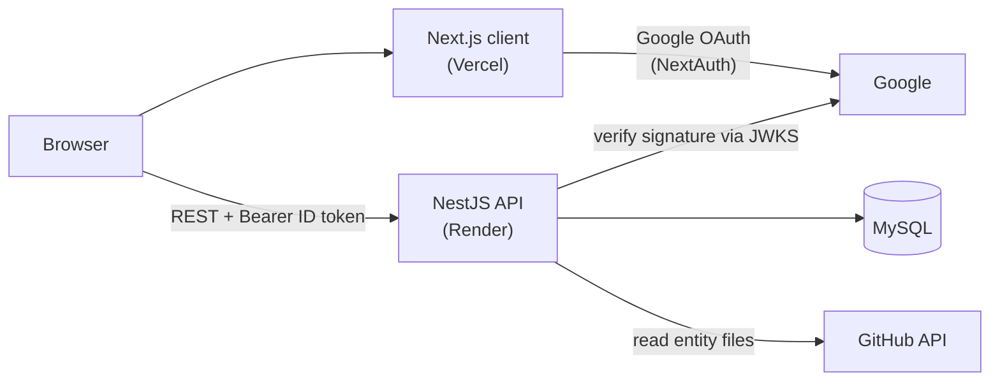

# RepoWaze

[](https://github.com/saralee7600/RepoWaze/actions/workflows/ci.yml)

Turn a GitHub repository into an interactive database diagram.

Paste a GitHub URL and RepoWaze reads the repository's TypeORM entities, parses them into tables, columns and relations, and renders the result as an explorable entity-relationship graph. Every user gets a private workspace of imported projects, secured with Google sign-in.

**Live demo:** https://repo-waze-three.vercel.app
(The API runs on Render, so the first request after a period of inactivity can take a few seconds.)

## Features

- **Import from GitHub** - paste `https://github.com/owner/repo`, `owner/repo` or an SSH URL. Importing the same repository twice is rejected.
- **Sync** - refresh a project's map from the latest code on GitHub with one click.
- **Static analysis, no code execution** - entities are parsed with the TypeScript compiler API (AST), never executed.
- **Interactive graph** - tables as nodes, relations (`one-to-one`, `one-to-many`, `many-to-one`, `many-to-many`) as edges, rendered with React Flow.
- **Entity details** - columns, types, nullability, primary and generated keys, declared relations.
- **Google sign-in** - each user only ever sees and modifies their own projects.
- **Dashboard** - project list with node and edge counts, delete with confirmation, light and dark theme.

## Architecture



| Package | Description |
|---|---|
| [`client/`](client) | Next.js (App Router), React 19, NextAuth, Tailwind CSS, shadcn/ui, React Flow, `react-hook-form` + `zod` |
| [`server/`](server) | NestJS 11, TypeORM, MySQL, Jest |
| [`shared/`](shared) | TypeScript interfaces shared by the client and the server |

### Authentication flow

1. The user signs in with Google through NextAuth. The Google **ID token** is kept in the NextAuth session and refreshed automatically before it expires.
2. The client attaches it to every API call as `Authorization: Bearer <id token>`.
3. A global NestJS guard verifies the token itself: RS256 signature against Google's public keys (cached JWKS), plus audience, issuer and expiry.
4. Every query is scoped to the authenticated user's Google `sub`. Accessing another user's project returns `404`, so project IDs cannot be enumerated.

### Security

- **Authentication on every route** via a global guard (see above); data access is always scoped to the authenticated user.
- **Input validation** - a global `ValidationPipe` with `class-validator` DTOs. Unknown properties are rejected (`forbidNonWhitelisted`), so clients cannot set fields such as `ownerId`.
- **Rate limiting** - `@nestjs/throttler`: 120 requests per minute per client IP, and 5 per minute for `POST /projects/import`, which fans out to many GitHub API calls. Exceeding a limit returns `429`.
- **Security headers** - `helmet` (HSTS, `X-Content-Type-Options`, CSP and more). `Cross-Origin-Resource-Policy` is set to `cross-origin`, because the browser client lives on a different origin than the API.
- **CORS allow-list** - only the origins listed in `CORS_ORIGINS`, with an explicit set of methods and headers.
- **No secrets in the repository** - configuration comes from environment variables; `.env` files are git-ignored.
- **No SSRF surface** - only `github.com` repositories are fetched, and owner and repository names are validated.

### Import pipeline

1. `GithubService` resolves the repository's default branch and lists `*.entity.ts` files (skipping `node_modules`, `dist`, `build` and `coverage`).
2. Files are fetched with bounded concurrency, request timeouts and size limits.
3. `EntityParserService` parses each file with the TypeScript AST and extracts `@Entity` classes, columns and relations.
4. Bidirectional relations are de-duplicated into a single edge.
5. The project, its nodes and its edges are saved in one transaction.

### API

All endpoints require a valid bearer token.

| Method | Path | Description |
|---|---|---|
| `GET` | `/projects` | List your projects with node and edge counts |
| `GET` | `/projects/:id` | Project with its nodes and edges |
| `POST` | `/projects/import` | Import a repository `{ repoUrl, name? }` (`409` if you already imported it) |
| `POST` | `/projects/:id/sync` | Re-read the repository and refresh the project's nodes and edges |
| `POST` / `PUT` / `DELETE` | `/projects`, `/projects/:id` | Create, update, delete |
| `GET` `POST` `PUT` `DELETE` | `/nodes`, `/edges` | CRUD for nodes and edges |

## Getting started

### Prerequisites

- Node.js 22 or newer
- MySQL 8
- A Google OAuth client ([create one](https://console.cloud.google.com/apis/credentials)) with the authorized redirect URI
  `http://localhost:3001/api/auth/callback/google`
- Optional: a GitHub personal access token (raises the API limit from 60 to 5,000 requests per hour and allows importing private repositories)

### 1. Shared types

```bash
cd shared
npm install
npm run build
```

### 2. Server

```bash
cd server
npm install
cp .env.example .env     # fill in the values below
npm run migration:run    # creates the database schema
npm run dev              # http://localhost:3000
```

### 3. Client

```bash
cd client
npm install
cp .env.example .env     # fill in the values below
npm run dev              # http://localhost:3001
```

### Environment variables

**Server (`server/.env`)**

| Variable | Description |
|---|---|
| `PORT` | HTTP port (default `3000`) |
| `DB_HOST`, `DB_PORT`, `DB_USER`, `DB_PASS`, `DB_NAME` | MySQL connection |
| `GOOGLE_CLIENT_ID` | Expected audience of incoming ID tokens - must match the client |
| `GITHUB_TOKEN` | Optional. GitHub token used for repository imports |
| `CORS_ORIGINS` | Optional. Comma-separated allowed origins (defaults to `http://localhost:3001` and the demo URL) |

**Client (`client/.env`)**

| Variable | Description |
|---|---|
| `NEXT_PUBLIC_API_URL` | Base URL of the API, e.g. `http://localhost:3000` |
| `NEXTAUTH_URL` | Public URL of the client, e.g. `http://localhost:3001` |
| `NEXTAUTH_SECRET` | Random secret for NextAuth, e.g. `openssl rand -base64 32` |
| `GOOGLE_CLIENT_ID`, `GOOGLE_CLIENT_SECRET` | Google OAuth credentials |

## Database migrations

The schema is managed with TypeORM migrations (`synchronize` is disabled). Database settings and the entity/migration paths live in a single place, [`server/src/config/database.config.ts`](server/src/config/database.config.ts), shared by the Nest app and the TypeORM CLI.

```bash
cd server
npm run migration:generate -- src/migrations/<Name>   # diff entities against the database
npm run migration:run
npm run migration:revert
```

In production, run the compiled CLI against `dist`:

```bash
node node_modules/typeorm/cli.js migration:run -d dist/config/typeorm.config.js
```

## Testing and quality

```bash
cd server
npm test          # Jest unit tests (auth guard, token verifier, services, controllers, DTO validation)
npm run build     # type-check and compile
npm run lint
```

## Limitations

- Only **TypeORM** projects are supported, and only entities declared in `*.entity.ts` files with the `@Entity()` decorator. Prisma, Sequelize and `EntitySchema` are not supported yet.
- An import is a snapshot. Changes pushed to GitHub afterwards are picked up when you press **Sync with GitHub** on the project page (there is no automatic or webhook-based sync). Syncing recreates the project's nodes and edges; if the repository can no longer be analysed, the existing data is kept.
- Only the repository's default branch is imported.
- At most 500 entity files and 1 MB per file are processed.
- Importing private repositories requires the server's `GITHUB_TOKEN` to have access to them.

## Deployment

- **Client:** Vercel. Set the client variables above (`NEXT_PUBLIC_API_URL` is inlined at build time, so redeploy after changing it) and add `https://<your-domain>/api/auth/callback/google` as an authorized redirect URI in Google Cloud.
- **Server:** Render. Set the server variables above and run the migrations against the production database before the first start.

## License

Released under the [MIT License](LICENSE).
